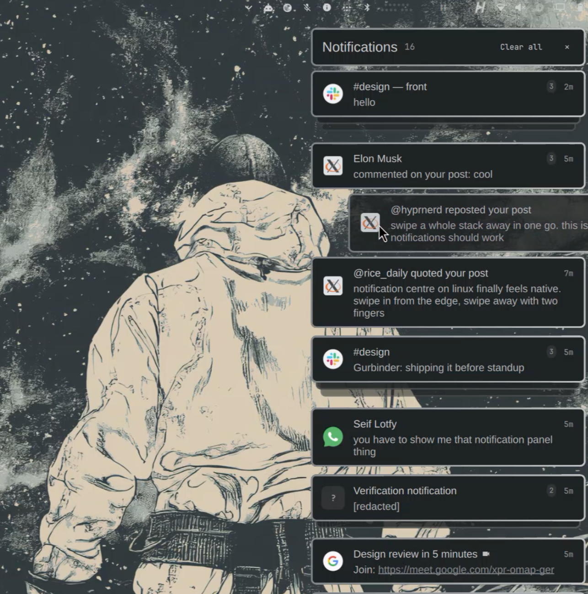

# Hyprbell

A notification daemon for [Omarchy](https://omarchy.org) that you use with your
hands: swipe notifications away with two fingers, pull in everything you missed
from the edge of the touchpad, and browse it all in a Notifications panel of
stacks that open as you point at them. Replaces the built-in notification
service and follows your Omarchy theme, down to the window border. Right-click
any notification for a menu of standing rules: never show these, keep them
silent, always let them through, clear the ones that keep coming back, or bring
this one back later.


Hyprbell started as a fork of Neil Jagdish Patel's
[Omapager](https://github.com/njpatel/omapager) and keeps everything it does -
grouping, inline actions, codes, replies, snoozing, screen-sharing detection.
See [Credits](#credits).

**Formerly Omapager Pro.** Same plugin and same id
(`io.github.dragosol.omapager-pro`), new name. If you have Omapager Pro,
`omarchy plugin update` brings you Hyprbell; there is nothing to reinstall.
Your history, snoozes, settings and icons folder move across by themselves the
first time it runs. The IPC target is now `hyprbell` (`omarchy-shell hyprbell
clear`, and so on); `omapager` still answers, so existing keybindings keep
working. The touchpad rule you may have installed, `70-omapager-touchpad.rules`,
grants the same access and keeps working too.

If you installed Hyprbell from `dragosol/omarchy-hyprbell` under the id
`io.github.dragosol.omapager-pro`, switch to this one: remove that plugin, then
install as below. Both read the same state folder, so history, snoozes and
rules carry over; only the bar-widget options in `shell.json` need copying
across to the new entry. Don't run both at once - only one notification daemon
can.

## What Hyprbell adds

**Gestures, everywhere a notification is.**

| | |
| --- | --- |
| Two fingers right on a card | throw it away - past a third of the way, or with a flick; short of that it springs back |
| Two fingers right on a stack's front card | throw the whole stack |
| Two fingers left on a card | reveal the whole Notifications panel, pulled in behind the card as your fingers move |
| Two fingers onto the touchpad over its right edge | pull in the Notifications panel, following your fingers, as on a Mac |
| Two fingers up and down | scroll a list taller than the screen - with momentum, and a stretch at either end |
| Mouse: drag a card right | throw it away, as with two fingers |
| Mouse: drag a card left | reveal the whole Notifications panel |
| Mouse: drag the panel heading right | put the panel away |
| Pointer into the top-right corner | the panel heading peeks in; run down the right edge onto it and the panel opens - no click |

**Never read this far?** Push any notification to the left - with two fingers
or by dragging it with the mouse - and the whole Notifications panel comes in
behind it. That is the one gesture worth knowing.

A third finger arriving late turns an edge swipe back into nothing, so
three-finger workspace swipes never catch the panel.




**The Notifications panel.** Everything on screen now plus everything you
missed - notifications that timed out, or were held back by a snooze or Do Not
Disturb. What you dismissed stays gone. Notifications already on screen travel
into the panel as it slides in; one stack per source, opened by resting the
pointer on its front card; **Clear stack** and **Clear all**; swipe the heading
to put it away. It closes itself once you leave it. Scroll a long panel and the cards
going past the top slide under the heading and pile up behind it like a shut
stack, instead of being cut off.

**Quieter cards.** The card border is your window border - the theme's active
border colour or gradient, and Hyprland's border width - with regular-weight
titles, soft count badges and unoutlined controls. Stacks show their count, open
decks hold long messages to three lines until you rest on one, and decks taller
than the screen scroll instead of running off it.

**Matches your windows.** Cards are as see-through as Hyprland draws an
unfocused window (your `default-opacity` rule, or `decoration:inactive_opacity`),
and blurred behind when `decoration:blur` is on.

## Features

**Screen-sharing detection.** When you share a screen, window or area through
the Hyprland portal, it offers to snooze notifications for 30 minutes,
1 hour or 4 hours. Nothing is muted until you choose. You can disable these
suggestions in preferences.

**Grouped notifications.** Messages from the same source stack together. Hover
to expand the group and read or act on each notification.

**Theme support.** Follows your Omarchy theme.

**Code, link and phone actions.** Copy verification codes and phone numbers, or
open links, directly from a notification. Multiple codes get separate buttons.

**Per-notification actions.** Use app-provided actions such as Mark as read
without opening the app.

**Inline replies.** Reply to supported KDE Connect messages without leaving the
notification. What you type, and the message it answers, are passed to the helper on its
standard input and handed to D-Bus from inside it, never as command-line arguments: a command
line is readable by every other account on the machine for as long as the process lives.
Copied verification codes go to the clipboard the same way.

**Window focus.** Click a notification to focus its app or browser window.
Web notifications open their source URL when no matching window is available.

**A menu for every notification.** Right-click any notification - on screen or
in the Notifications panel - for a menu that opens where you clicked:

| | |
| --- | --- |
| Notify later | put this one away and bring it back in 15 minutes, an hour, 3 hours or tomorrow morning (survives a restart) |
| Snooze app | hold everything from the app back for a while; it waits in the panel |
| Copy text / Copy code | the title and message, or the verification code (copied as sensitive) |
| Clear stack | every notification from the app in this stack |
| Deliver: Never | never bother you with these: not on screen, not in the panel |
| Deliver: Silent | straight to the Notifications panel, never on screen |
| Deliver: Always | shown even through Do Not Disturb and snoozes |
| Auto-clear after 2× / 3× / 5× | the same message coming back again and again is cleared, with its copies, once it has tried that many times |
| Clear older than 1h / 1d / 1w | cleared from the screen and the panel once older than that |
| Never keep sticky | urgent ones time out like the rest instead of waiting for you |
| Do Not Disturb, Clear everything | as in the bar panel |

Rules apply to the whole app, or - with the chips on the "Rules for" row - only
to notifications with the same title (for a chat app, the same sender). The
narrower rule wins. Point at anything in the menu and its footer says what it
does; at rest the footer says which rules are in force. Every rule is listed
under **Rules** in the bar panel, where it can be forgotten - the only way back
from a "Never", since nothing it covers reaches the screen to right-click.

**Snooze and Do Not Disturb.** Snooze a source from its right-click menu.
Use the bar panel to snooze everything or toggle Do Not Disturb.

**Verification-code exception.** Let login codes through while notifications
are snoozed or silenced. Turn this off with the key button in the bar panel.

**Held notifications.** Read messages received while a source was snoozed in
the bar panel's Held Back section.

**Recent notifications.** Review recently dismissed or expired notifications
by expanding Recent in the bar panel. The list clears when the shell restarts.

**Notification history.** Expand History to read up to 100 closed notifications,
newest first, including messages held while snoozed or silenced. Unlike Recent,
this list survives shell restarts and refreshes each time the panel opens.
Click a card to expand its message, then scroll to read the rest. `historyHours`
controls retention; `0` disables disk history - and then a "Notify later" is held
in memory until it is due, so it does not survive a shell restart. Detected verification codes stay
redacted.

**Source icons.** Use local icons or fetch missing website icons automatically.
Set `fetchRemoteIcons` to `false` in the config to disable fetching.
Sender-provided image files are decoded by a bounded helper and kept in memory
for the live toast. Rejected files fall back to the resolved source icon.

## Install

Check the [requirements](#requirements), choose one installation method in
step 1, then enable Hyprbell in step 2.

### 1. Install

#### Via the marketplace

Find Hyprbell in the [Omarchy Plugin Marketplace](https://omarchyplugins.com/)
and run its install command:

```bash
omarchy plugin add https://github.com/dragosol/omarchy-omapager-pro.git
```

#### Via Git

```bash
git clone https://github.com/dragosol/omarchy-omapager-pro.git \
  ~/.config/omarchy/plugins/io.github.dragosol.omapager-pro
```

### 2. Enable Hyprbell

Disable the built-in notification service - or the original Omapager, if you
have it - and enable Hyprbell. Only one notification daemon can run at a time.

```bash
omarchy-shell shell rescanPlugins
omarchy plugin disable omarchy.notifications
omarchy plugin enable io.github.dragosol.omapager-pro --section center --after omarchy.indicators
omarchy restart shell
```

Hyprbell keeps its state where Hyprbell does, so switching over keeps your
history, snoozes and icons.

### 3. Optional: the edge swipe

Pulling the panel in from the touchpad's edge reads finger positions from the
touchpad itself, which needs read access to it. That takes one udev rule,
added once by hand - the whole rule is the one line below, so you can read
exactly what is being given, and nothing from the plugin folder runs as root:

```bash
echo 'SUBSYSTEM=="input", KERNEL=="event*", ENV{ID_INPUT_TOUCHPAD}=="1", TAG+="uaccess"' \
  | sudo tee /etc/udev/rules.d/70-hyprbell-touchpad.rules
sudo udevadm control --reload
sudo udevadm trigger --subsystem-match=input --action=change
omarchy restart shell
```

The rule gives the logged-in user access to devices udev has classified as
touchpads - not the keyboard, not other input - through the standard
systemd-logind `uaccess` handoff, so access follows whoever is at the seat and
ends when they log out. The reader runs in the same Bubblewrap sandbox as the
other helpers, with that one device node and nothing else. Everything else
works without it, including the hot corner, left pulls and the `missed`
command.

To take the rule away again (from Omapager Pro it may be called
`70-omapager-touchpad.rules`):

```bash
sudo rm -f /etc/udev/rules.d/70-hyprbell-touchpad.rules /etc/udev/rules.d/70-omapager-touchpad.rules
sudo udevadm control --reload
sudo udevadm trigger --subsystem-match=input --action=change
```

### Updates

```bash
omarchy plugin update io.github.dragosol.omapager-pro
omarchy restart shell
```

Do not use `omarchy refresh shell`, which resets your shell configuration.

### Remove Hyprbell

```bash
omarchy plugin disable io.github.dragosol.omapager-pro
omarchy plugin remove io.github.dragosol.omapager-pro
omarchy plugin enable omarchy.notifications
omarchy restart shell
```

If you added the touchpad rule, remove it as in
[step 3](#3-optional-the-edge-swipe).

Removal keeps notification history, icon cache and other state in
`~/.local/state/omarchy/hyprbell/`. Delete that directory separately if you also
want to remove the stored data. A per-source icon you dropped into
`~/.config/omarchy/hyprbell/icons/` stays too.

## Settings

Right-click the bar indicator to open its panel, then click the settings cog
to choose a notification display, choose when to step aside for fullscreen
windows, toggle countdown animation or control screen-sharing snooze
suggestions.

Changes save to the `io.github.dragosol.omapager-pro` bar-widget entry in
`~/.config/omarchy/shell.json`. You can edit the other options there too.
`edgeSpacing`, `fetchRemoteIcons` and `requireSandbox` are config-only. Defaults
below apply to new configurations, not choices you have already saved.

### Hyprbell options

| Option | Default | Purpose |
| --- | --- | --- |
| `stacking` | `source` | `source` gives each sender a deck. `all` uses one deck. |
| `displayMode` | `active` | `active` follows focus for new decks. `specific` uses `displayName`. `all` mirrors notifications. Visible decks stay put in active mode. |
| `displayName` | empty | Output for specific mode, such as `DP-1`. Hyprbell keeps the selection while disconnected and falls back to a connected display. |
| `fullscreenOverlay` | `off` | Step aside for fullscreen windows so the compositor can scan them out directly. `all` steps aside for any fullscreen window, `steam` only for Steam games (`steam_app_*`); both come back to show a notification. `all-away` and `steam-away` never cover the fullscreen display and send notifications to another display, or to history when there is none. |
| `edgeSpacing` | `12` | Gap from the bar and screen edges, in logical pixels from 0 to 64. Config-only. |
| `showCountdown` | `false` | Show the time-remaining animation. Turning it off does not change expiry. |
| `edgeSwipe` | `true` | Pull the Notifications panel in with two fingers from the touchpad's right edge. Needs the one-time touchpad rule from [install step 3](#3-optional-the-edge-swipe). |
| `offerSnoozeWhenSharing` | `true` | Suggest a timed snooze when portal sharing starts. Never mute automatically. |
| `fontScale` | `100` | Notification text size as a percentage, from 75 to 200. Does not resize bar or panel text. |
| `actionsAlign` | `right` | Align action buttons to the `right` or `left`. |
| `hideSettingsAction` | `true` | Hide the browser's repeated Settings action. |
| `snoozeDurations` | `30, 60, 240, tomorrow` | Offer `15`, `30`, `60`, `120`, `240` or `480` minutes, or `tomorrow`. An empty selection uses the defaults. |
| `wakeHour` | `8` | Wake hour for `tomorrow`, from 0 to 23. Currently `0` falls back to `8`. |
| `smartRaise` | `true` | Match notification websites against browser window titles when focusing a window. |
| `alwaysShow` | `false` | Keep the bar indicator visible when nothing is held back. |
| `codesBypassQuiet` | `true` | Let verification codes through snooze and Do Not Disturb. |
| `timeFormat` | `system` | Use the `LC_TIME` locale, or choose `24h` or `12h`. |
| `sourceLimit` | `8` | Number of quietened sources listed in the panel, from 2 to 20. |
| `heldPerSource` | `10` | Held notifications shown per source, from 3 to 25. |
| `recentCount` | `5` | Recent notifications shown in the panel, from 1 to 20. Clears on shell restart. |
| `fetchRemoteIcons` | `true` | Fetch missing website icons. Turning it off keeps local and validated cached icons. Requires Pillow. Config-only. |
| `requireSandbox` | `false` | Require Bubblewrap instead of allowing helpers to run directly when it is unavailable. Config-only. |
| `allowDefaultActionOnCardClick` | `true` | A card click runs the app's default action - Ghostty focusing the terminal a "Claude is waiting" toast came from, say - as Omarchy's own notification service does. Off, a click only focuses a known window or opens the source's site. |
| `historyHours` | `24` | Keep disk history for `1`, `24` or `168` hours, with a 100-entry cap. `0` disables it. |
| `clipboardTimeout` | `60` | Clear copied codes after `30`, `60` or `90` seconds, unless the clipboard has changed. |

Add options to the existing widget entry. This example is not a complete
`shell.json` file:

```json
{
  "id": "io.github.dragosol.omapager-pro",
  "edgeSpacing": 12,
  "showCountdown": false,
  "fontScale": 100,
  "historyHours": 24
}
```

### Appearance inherited from Omarchy

Theme overrides belong in `~/.config/omarchy/shell.toml`, not the plugin's
`shell.json` entry. Your overrides take precedence over the active theme and
apply to other Omarchy components that use the same settings.

| Appearance | Omarchy setting |
| --- | --- |
| Notification colours | `[notifications]` background, text, border and countdown colours |
| Card border width | `[notifications] border-width`, including per-side overrides. The fallback is 2 logical pixels at the default scale, as in stock notifications. |
| Panel colours and border | `[popups]` |
| Corner rounding | Hyprland's `decoration:rounding` |
| Text sizes | `[font]`. Titles and message text use Liberation Sans. Controls use the shared UI font. |
| Button and switch states | `[controls]` |
| Internal spacing and padding | `[spacing]` |

For example, set the notification border width in `~/.config/omarchy/shell.toml`:

```toml
[notifications]
border-width = 2
```

The `edgeSpacing` option is separate from Omarchy's outer gaps. It keeps the
configured distance regardless of the theme's spacing scale or Hyprland's
`general:gaps_out`. At 2x display scaling, 12 logical pixels occupy 24 physical
pixels.

### Sharing detection

Hyprbell detects screen, window and area sharing through the Hyprland portal.
It uses stream metadata, not your screen content. Click the sharing indicator
to snooze for 30 minutes, 1 hour or 4 hours, or choose Not now.

An existing global snooze or Do Not Disturb suppresses the offer. Each sharing
period gets one offer, even with multiple streams. A chosen snooze lasts for its
selected duration, regardless of when sharing ends. Critical alerts and the
configured verification-code exception still apply.

Portal-based recording can trigger detection. Screenshots, direct VNC capture and
apps that bypass the portal do not. Hyprbell tracks up to 64 video-source nodes.
Restarting the shell during a share can show the offer again. Disable suggestions
in preferences or set `offerSnoozeWhenSharing` to `false`.

## The bar

The indicator appears while notifications are held back or a sharing offer is
waiting. Hover the centre of the bar to reveal it at other times.

| Indicator | Meaning |
| --- | --- |
| Crossed-out bell in the urgent colour | Do Not Disturb |
| Sleeping bell in the accent colour | A source or all notifications are snoozed |
| Sharing icon in the accent colour | Sharing detected. Click to choose a snooze. |
| Dimmed bell | Nothing held back |

Left-click the bell to silence or resume notifications. Right-click to open the
panel for Recent, History, held messages and snooze controls.

## Keybindings

Omarchy's existing comma-key shortcuts work without configuration:

| | |
| --- | --- |
| `SUPER` `,` | dismiss the newest notification |
| `SUPER` `SHIFT` `,` | dismiss the whole stack the newest one is in (or the one you have open) |
| `SUPER` `CTRL` `,` | toggle silencing |
| `SUPER` `ALT` `,` | invoke the newest one, as clicking it would |
| `SUPER` `SHIFT` `ALT` `,` | put the last few back on screen |

Omarchy screenshot toasts carry `omarchy-exec-argv`. Click and Super+Alt+, open the
screenshot in that editor, and only that: the editor gets the image and no options. The same gestures open a Taildrop notification's local file or launch
Omarchy's configured agent to diagnose a crash by PID. Crash details are retrieved
by the agent, not taken from notification-supplied metadata. Taildrop opening
requires an existing non-executable regular file at an absolute path; URLs,
traversal, final symlinks and `.desktop` launchers are refused. These actions are
checked again when activated and are never restored from history. They do not
require `allowDefaultActionOnCardClick`.

### Optional bindings

Check for conflicts with `omarchy menu keybindings --print` before adding these
to `~/.config/hypr/bindings.lua`. Use `hl.unbind` to remove a conflicting binding.

```lua
-- Copy the newest code and dismiss its notification.
o.bind("SUPER + ALT + C", "Copy code from newest notification",
       "omarchy-shell hyprbell offer code")

-- Snooze all sources for an hour.
o.bind("SUPER + CTRL + ALT + comma", "Snooze all notifications for an hour",
       "omarchy-shell hyprbell snoozeAll 60")

-- Toggle the notification panel.
o.bind("SUPER + CTRL + SHIFT + comma", "Notification options",
       "omarchy-shell hyprbell.panel toggle")

-- The Notifications panel, for a keyboard.
o.bind("SUPER + SHIFT + N", "Notifications",
       "omarchy-shell hyprbell missed")
```

## Scripting

```
omarchy-shell hyprbell count            how many are on screen
omarchy-shell hyprbell clear            dismiss them
omarchy-shell hyprbell dnd              toggle Do Not Disturb
omarchy-shell hyprbell expand           open the deck, as hovering would
omarchy-shell hyprbell offer code       take the front card's offer (code|link|phone)
omarchy-shell hyprbell act reply        invoke one of the sender's actions
omarchy-shell hyprbell reply "text"     answer the front card ("" opens the field)
omarchy-shell hyprbell snooze 60        quieten the front card's source, in minutes
omarchy-shell hyprbell snoozeAll 60     quieten everything for 60 minutes, or wake it
omarchy-shell hyprbell codes off        stop letting verification codes through
omarchy-shell hyprbell unsnooze ""      wake everything ("" for all, or a source key)
omarchy-shell hyprbell snoozes          what is snoozed, and until when
omarchy-shell hyprbell stack source     switch stacking mode
omarchy-shell hyprbell align right      switch which end the buttons sit at
omarchy-shell hyprbell probe            show runtime configuration and helper status as JSON
omarchy-shell hyprbell missed           open or close the Notifications panel ("open" / "close")
omarchy-shell hyprbell swipe 200        throw the front card as a 200px swipe would
omarchy-shell hyprbell scroll 120       scroll a deck taller than the screen
omarchy-shell hyprbell edge "begin"     drive the edge swipe by hand: begin, move <p>, end <p> <v>, cancel

omarchy-shell hyprbell.panel toggle     the panel
omarchy-shell hyprbell.panel expand x   open a source's held list, as clicking it would
omarchy-shell hyprbell.panel openSettings  notification preferences
```

## Demo

```bash
bin/hyprbell-demo                       # the everyday scenes
bin/hyprbell-demo --scene interactive   # codes, links, and the sender's buttons
bin/hyprbell-demo --scene routing       # where a click sends you, per source
bin/hyprbell-demo --scene reply --keep --timeout 30000  # local inline-reply demo
bin/hyprbell-demo --scene close         # dismiss a stack without moving the pointer
bin/hyprbell-demo --replay 40           # your own notifications, re-sent (over the bus, never on a command line)
bin/hyprbell-demo --scene showcase      # a mix of senders and stacks, for a screenshot
bin/hyprbell-demo --list
```

The demos use the original named conversations and source icons. Add `--keep`
to leave existing notifications on screen.

The routing scene lists the window or URL each notification should open. The
reply scene lets you type and send a reply without contacting a phone. It saves
the latest reply in `~/.local/state/omarchy/hyprbell/reply-demo/reply.json`.
Each run creates a new demo session, which expires after 30 minutes.

`--scene close` keeps three cards on screen with live default actions. Repeatedly
click the front close control without moving the pointer, waiting for each card
to settle. All three should dismiss; any `default` output means a card opened
instead.
For the default-action check, enable `allowDefaultActionOnCardClick` in the
lab's widget settings first; strict mode does not invoke default actions on
card-body clicks.

## Security

### Automatic website icons

Hyprbell checks local icons and its cache before fetching from a website.
Website-icon fetching is on by default. Set `"fetchRemoteIcons": false` in the
widget's `shell.json` entry to stop requests and cancel the active lookup.
Local and validated cached icons still work. Saved opt-outs survive upgrades.

Requests expose your IP and request time to the source website and its icon
hosts. They contain no notification text, verification codes, browser cookies or
authentication headers. Hyprbell does not use a third-party favicon service or
guess parent domains.

These protections apply with or without Bubblewrap:

- HTTPS on port 443 with TLS 1.2 or newer. Hyprbell rejects URL credentials,
  IP literals and local or private destinations.
- Every DNS answer must be public. Connections use those checked addresses,
  with certificate validation for the original hostname.
- Redirects and icon URLs receive the same checks. Proxy environment variables
  cannot bypass them.
- Downloads have redirect, byte and time limits. Pillow validates image formats
  and dimensions, then re-encodes icons as small PNGs. Remote SVGs are rejected.

Keep Python, Pillow and the system libraries updated. These checks do not protect
against another process running as your user and modifying the local cache.

### Optional helper sandbox

Storage, icon and KDE Connect helpers use Bubblewrap when its startup check
succeeds. Otherwise they run directly as your user, with your account's normal
filesystem and network access. Input validation and resource limits still apply.

Set `"requireSandbox": true` in the widget's `shell.json` entry to block helpers
when sandboxing is unavailable. This affects persistence, icon lookup and phone
replies. The saved policy applies before startup helpers run. A failed helper
is never retried without its sandbox.

Sandboxed helpers receive access to the files they need. Remote icons still need
network access, and KDE Connect receives the session bus without destination
filtering. Bubblewrap does not isolate the QML shell itself.

Run `omarchy-shell hyprbell probe` to check whether helpers use `sandboxed`,
`direct` or `blocked` mode. See [the security architecture](docs/SECURITY_ARCHITECTURE.md)
for the exact limits and access rules.

### Stored notifications and clipboard

Disk history defaults to 24 hours and 100 entries. Hyprbell redacts detected
verification-code notifications before saving them, but detection cannot identify
every secret. Copied codes clear after the configured timeout only if the
clipboard still contains the same code.

Two things from the right-click menu are kept as well. A rule is saved in
`quiet.json` beside the snoozes; a rule for one title keeps that title (often a
sender's name), and it stays until you forget the rule in the bar panel. A
notification is never offered a per-title rule if it carries a verification
code. "Notify later" keeps the same redacted copy history would, under
`later/`, and deletes it when it is shown - or holds it in memory only, when
`historyHours` is `0`.

State lives in `~/.local/state/omarchy/hyprbell/`. See [settings](#settings) for
retention and clipboard options, and [SECURITY.md](SECURITY.md) to report a
vulnerability.

## Requirements

- Omarchy with Quickshell 0.3.x and Hyprland.
- Python 3 for the helpers, with GObject introspection (`python-gobject`) so a reply can be
  handed to KDE Connect over D-Bus from inside the helper. Without it, replies fail rather
  than falling back to a command line that other local accounts could read.
- Pillow, packaged as `python-pillow`, for remote website icons and sender-provided
  image files. Without it, sender files fall back to local theme icons.
- Bubblewrap, packaged as `bubblewrap`, is optional unless `requireSandbox` is on.
- `wl-clipboard` is recommended for sensitive clipboard handling.
- KDE Connect and its phone app are required for phone notifications and replies.

See [Security](#security) for icon-fetching and sandbox behaviour.

## Contributing

Issues and pull requests are welcome at
[dragosol/omarchy-omapager-pro](https://github.com/dragosol/omarchy-omapager-pro).
The [development guide](docs/DEVELOPING.md) covers how the daemon is built and
tested; `tests/virtual_touchpad.py` drives real two-finger swipes through
libinput and Hyprland for testing gestures.

## Licence

MIT. See [LICENSE](LICENSE).

## Credits

Hyprbell is built on [Omapager](https://github.com/njpatel/omapager) by
Neil Jagdish Patel, MIT-licensed; his copyright notice is kept in
[LICENSE](LICENSE). The notification daemon, grouping, inline actions, replies,
snoozing, the security model and most of what is described under Settings and
Security are his work. The gestures, the Notifications panel, the hot corner and
the card styling are Hyprbell's.
